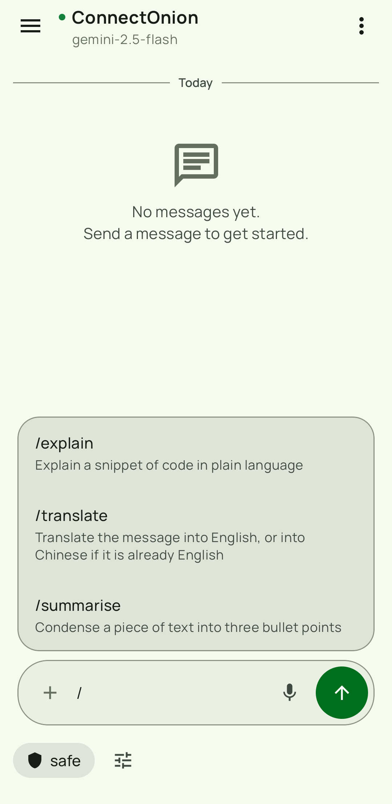
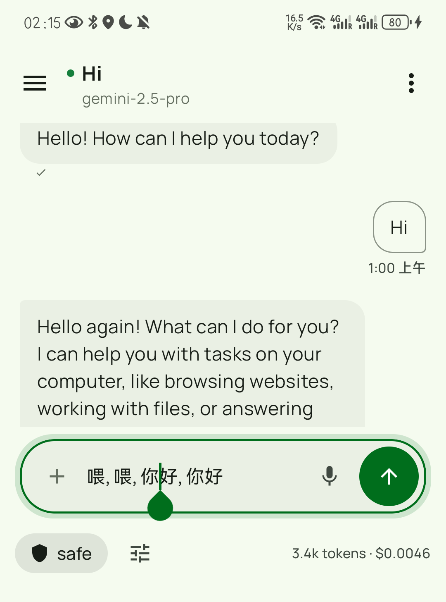
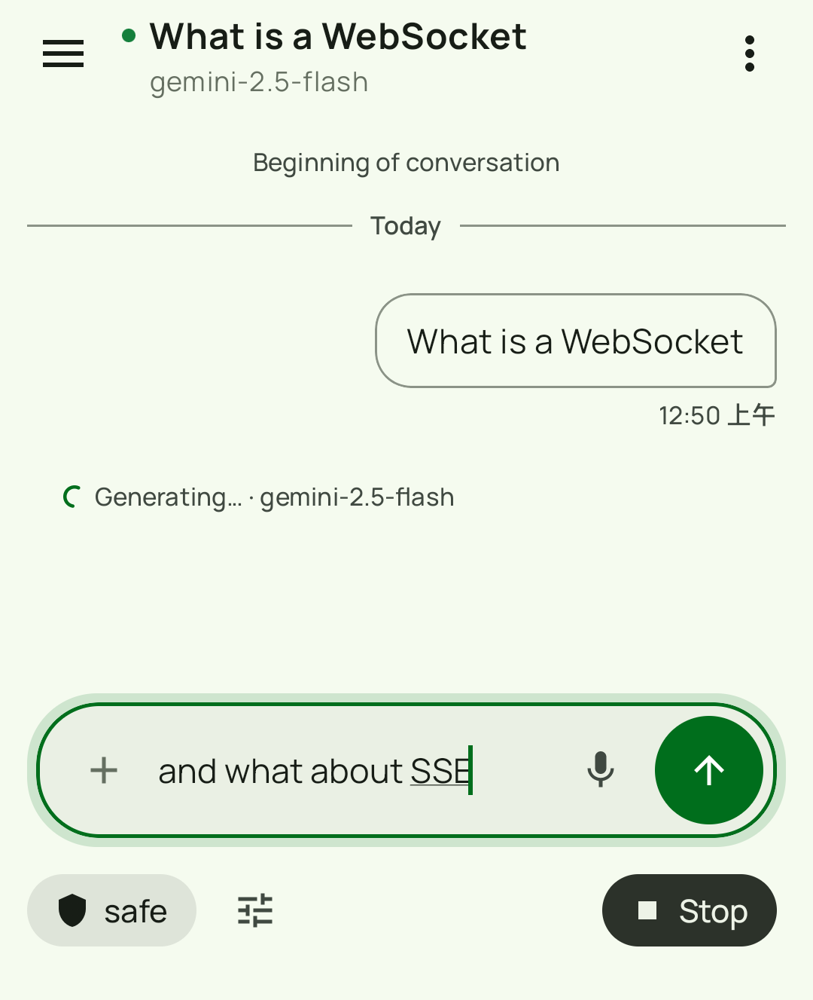
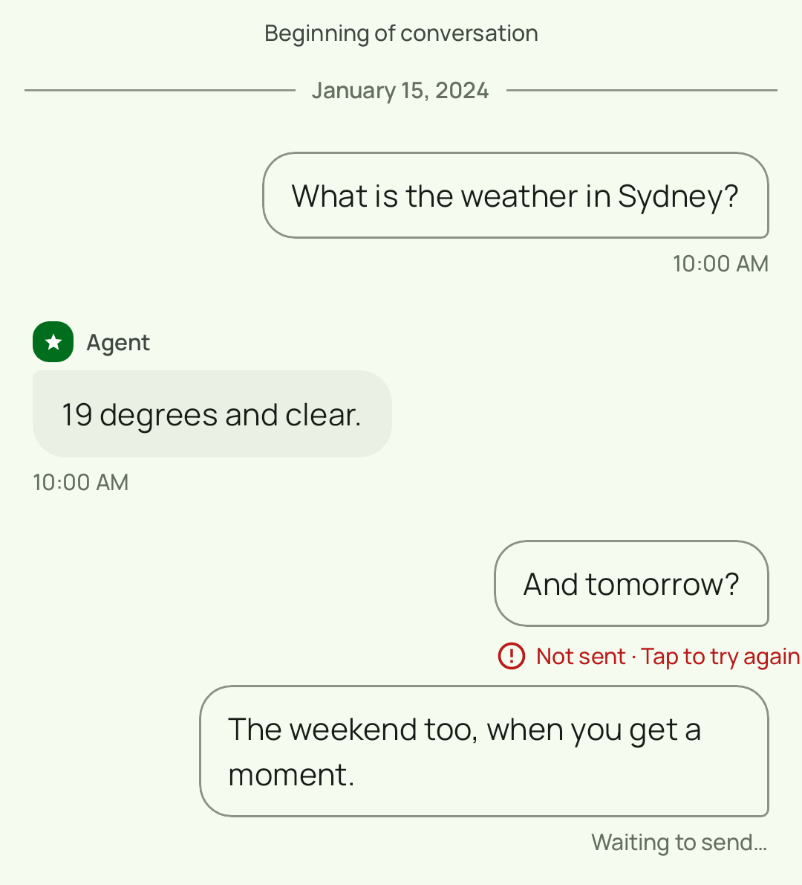
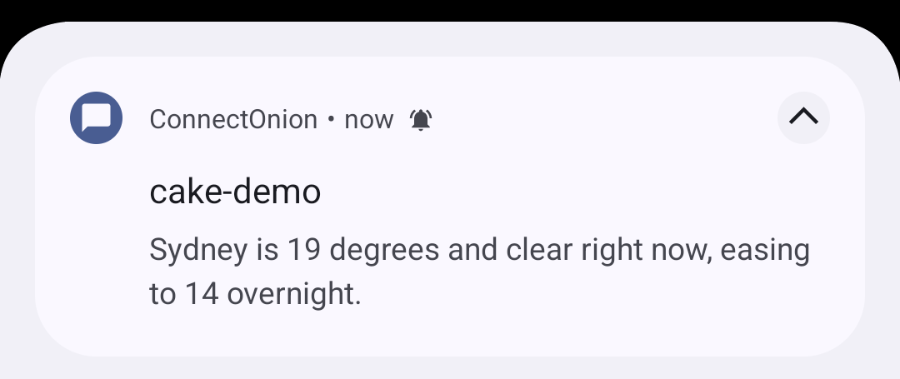

# oochat for Android

[](https://github.com/openonion/oochat-android/actions/workflows/build.yml)
[](https://github.com/openonion/oochat-android/actions/workflows/audit.yml)

Native Android chat client for [ConnectOnion](https://docs.connectonion.com/)
agents, built with Kotlin and Jetpack Compose. Connect to an agent by its `0x…`
address and talk to it — the same protocol the
[web client](https://github.com/openonion/oo-chat) speaks.

## Who this is for

This is a starting point, not a finished product you are meant to use as-is.

If you are running ConnectOnion agents and your users want a native Android app
rather than a browser tab, fork this, change the four things under
[Make it yours](#make-it-yours), and ship it. The web client is the default
answer; this exists for when the default is not enough.

## What it does

### Slash-command palette

Type `/` in the composer and the agent's published skills appear as a list, each
with the description the agent gave it. The list comes from the agent itself — an
agent that publishes nothing shows an empty palette rather than a stale or
invented one.



### Dictation lands in the composer, not in the chat

Speak instead of typing and the transcript arrives **in the text field**, where
you can fix a misheard word before anything is sent. A recogniser that mishears a
name no longer costs you a message.



### Keep typing while the agent is working

The composer stays usable while a reply is streaming, so a follow-up or a
correction can be sent mid-run. The agent picks it up as part of the same turn.

This needs `runtime_input` on the agent, which is opt-in
(`Agent(plugins=[runtime_input])`). Without it the relay acknowledges the
mid-run message and queues it, and nothing drains the queue.



### A message that did not send says so

Failed sends are marked and can be retried, rather than disappearing into the
transcript as though they had gone.



### Replies reach you when you are elsewhere

A notification arrives when a reply lands and the app is in the background.



### And the rest

- Multiple sessions per agent, in a drawer, renameable
- Agent discovery and invite-code onboarding
- **BIP39 recovery phrase** — generated the same way as the web client, so a
  phrase created in one restores the identical identity in the other
- Ed25519 signing via lazysodium; credentials in EncryptedSharedPreferences
  (AES256-GCM)
- Room-backed history: agents, sessions, messages, session state

### What it does not do

- No tablet-specific layout — it runs on tablets, but the layout is the phone one
- Mid-run input needs the agent to opt in (see above)
- Instrumented UI tests need an attached device; CI does not run them

## Requirements

| | |
|---|---|
| Android | 8.0 (API 26) or later |
| Build | JDK 17, Android SDK with the API 36 platform |
| Android Studio | Hedgehog (2023.1.1) or newer |
| An agent | See [connectonion](https://github.com/openonion/connectonion) — `pip install connectonion`, then `co init` |

## Build and run

```bash
git clone https://github.com/openonion/oochat-android.git
cd oochat-android

./gradlew :app:assembleDebug        # build
./gradlew :app:installDebug         # install on a connected device or emulator
./gradlew :app:testDebugUnitTest    # unit tests
./gradlew :app:jacocoTestReport     # coverage
```

Instrumented and Compose UI tests need a device attached:

```bash
./gradlew :app:connectedDebugAndroidTest
```

Screenshot baselines are checked with
[Roborazzi](https://github.com/takahirom/roborazzi):

```bash
./gradlew :app:verifyRoborazziDebug
```

> **The committed baselines are stale and CI does not check them.** A fixture in
> `SettingsScreenshotTest` was changed during the rebrand, so the baseline images
> no longer match what the test renders, and `verifyRoborazziDebug` is not run in
> CI. Nothing else covers this either — baselines are PNGs, and the
> pre-publication audit does not read images. Regenerate them with
> `./gradlew :app:recordRoborazziDebug` on a machine with the Android SDK before
> relying on screenshot coverage.

See [INSTALL.md](INSTALL.md) for a clean-machine walkthrough and
[USER_GUIDE.md](USER_GUIDE.md) for the app itself.

## Configure

| What | Where | Default |
|---|---|---|
| Relay endpoint | In-app settings | `oo.openonion.ai` |
| Agent address | Added in-app by `0x…` address | — |

## Make it yours

| # | What | Where |
|---|---|---|
| 1 | Application ID | `app/build.gradle.kts` — currently `ai.openonion.oochat` |
| 2 | Display name | `app/src/main/res/values/strings.xml` |
| 3 | Icon | `app/src/main/res/mipmap-*` |
| 4 | Relay endpoint | In-app settings, or the default in `Constants.kt` |

## Architecture

Compose UI over view models over a repository layer, with the WebSocket protocol
client underneath. `ui/` renders, `domain/` holds the models, `data/` owns Room
and the preference stores, `network/` owns the relay connection, and `crypto/`
owns the Ed25519 identity and BIP39 recovery.

An architecture test (`ArchitectureGuardTest`) enforces the layering: UI code
cannot import repository implementations, DAOs, or the WebSocket factory
directly. If you restructure, that test is where the rules are written down.

See [docs/architecture.md](docs/architecture.md) and
[docs/protocol.md](docs/protocol.md).

## Releases

Installable debug-signed APKs are published from semantic version tags. See
[the release guide](docs/RELEASE.md) for the version bump, dry-run and tagging
procedure, and [INSTALL.md](INSTALL.md) for installation and checksum
verification.

## Contributing

Issues and pull requests are welcome at
<https://github.com/openonion/oochat-android>.

## License

MIT — see [LICENSE](LICENSE).

Copyright (c) 2026 ConnectOnion PTY LTD.
=======
# project


## Getting started

To make it easy for you to get started with GitLab, here's a list of recommended next steps.

Already a pro? Just edit this README.md and make it your own. Want to make it easy? [Use the template at the bottom](#editing-this-readme)!

## Add your files

* [Create](https://docs.gitlab.com/user/project/repository/web_editor/#create-a-file) or [upload](https://docs.gitlab.com/user/project/repository/web_editor/#upload-a-file) files
* [Add files using the command line](https://docs.gitlab.com/topics/git/add_files/#add-files-to-a-git-repository) or push an existing Git repository with the following command:

```
cd existing_repo
git remote add origin https://gitlab.cse.unsw.edu.au/coursework/comp3900/26t3/capstone-projects/3900-w16a-apple/project.git
git branch -M main
git push -uf origin main
```

## Integrate with your tools

* [Set up project integrations](https://gitlab.cse.unsw.edu.au/coursework/comp3900/26t3/capstone-projects/3900-w16a-apple/project/-/settings/integrations)

## Collaborate with your team

* [Invite team members and collaborators](https://docs.gitlab.com/user/project/members/)
* [Create a new merge request](https://docs.gitlab.com/user/project/merge_requests/creating_merge_requests/)
* [Automatically close issues from merge requests](https://docs.gitlab.com/user/project/issues/managing_issues/#closing-issues-automatically)
* [Enable merge request approvals](https://docs.gitlab.com/user/project/merge_requests/approvals/)
* [Set auto-merge](https://docs.gitlab.com/user/project/merge_requests/auto_merge/)

## Test and Deploy

Use the built-in continuous integration in GitLab.

* [Get started with GitLab CI/CD](https://docs.gitlab.com/ci/quick_start/)
* [Analyze your code for known vulnerabilities with Static Application Security Testing (SAST)](https://docs.gitlab.com/user/application_security/sast/)
* [Deploy to Kubernetes, Amazon EC2, or Amazon ECS using Auto Deploy](https://docs.gitlab.com/topics/autodevops/requirements/)
* [Use pull-based deployments for improved Kubernetes management](https://docs.gitlab.com/user/clusters/agent/)
* [Set up protected environments](https://docs.gitlab.com/ci/environments/protected_environments/)

***

# Editing this README

When you're ready to make this README your own, just edit this file and use the handy template below (or feel free to structure it however you want - this is just a starting point!). Thanks to [makeareadme.com](https://www.makeareadme.com/) for this template.

## Suggestions for a good README

Every project is different, so consider which of these sections apply to yours. The sections used in the template are suggestions for most open source projects. Also keep in mind that while a README can be too long and detailed, too long is better than too short. If you think your README is too long, consider utilizing another form of documentation rather than cutting out information.

## Name
Choose a self-explaining name for your project.

## Description
Let people know what your project can do specifically. Provide context and add a link to any reference visitors might be unfamiliar with. A list of Features or a Background subsection can also be added here. If there are alternatives to your project, this is a good place to list differentiating factors.

## Badges
On some READMEs, you may see small images that convey metadata, such as whether or not all the tests are passing for the project. You can use Shields to add some to your README. Many services also have instructions for adding a badge.

## Visuals
Depending on what you are making, it can be a good idea to include screenshots or even a video (you'll frequently see GIFs rather than actual videos). Tools like ttygif can help, but check out Asciinema for a more sophisticated method.

## Installation
Within a particular ecosystem, there may be a common way of installing things, such as using Yarn, NuGet, or Homebrew. However, consider the possibility that whoever is reading your README is a novice and would like more guidance. Listing specific steps helps remove ambiguity and gets people to using your project as quickly as possible. If it only runs in a specific context like a particular programming language version or operating system or has dependencies that have to be installed manually, also add a Requirements subsection.

## Usage
Use examples liberally, and show the expected output if you can. It's helpful to have inline the smallest example of usage that you can demonstrate, while providing links to more sophisticated examples if they are too long to reasonably include in the README.

## Support
Tell people where they can go to for help. It can be any combination of an issue tracker, a chat room, an email address, etc.

## Roadmap
If you have ideas for releases in the future, it is a good idea to list them in the README.

## Contributing
State if you are open to contributions and what your requirements are for accepting them.

For people who want to make changes to your project, it's helpful to have some documentation on how to get started. Perhaps there is a script that they should run or some environment variables that they need to set. Make these steps explicit. These instructions could also be useful to your future self.

You can also document commands to lint the code or run tests. These steps help to ensure high code quality and reduce the likelihood that the changes inadvertently break something. Having instructions for running tests is especially helpful if it requires external setup, such as starting a Selenium server for testing in a browser.

## Authors and acknowledgment
Show your appreciation to those who have contributed to the project.

## License
For open source projects, say how it is licensed.

## Project status
If you have run out of energy or time for your project, put a note at the top of the README saying that development has slowed down or stopped completely. Someone may choose to fork your project or volunteer to step in as a maintainer or owner, allowing your project to keep going. You can also make an explicit request for maintainers.

